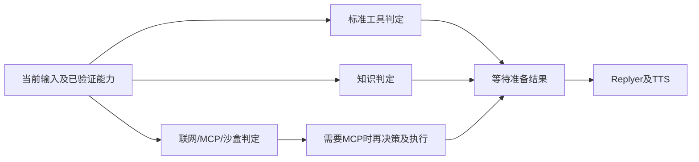
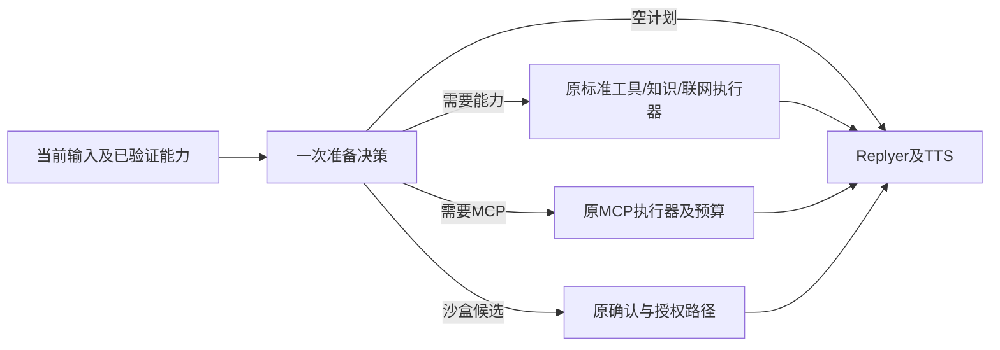

# 通话回复准备：合并判定方案（未采用）

2026-10-15。用户选择“语音通话绕过mcp判定”。本方案保留为历史设计，不实施合并判定；改为私聊和群聊通话语音逐消息声明 `mcp_enabled=false`，普通文字维持默认 MCP 行为。标准工具、知识、联网、选模和执行权限保持原有边界。

## 需要解决的问题

真实私聊输入907163、907179、907191均为“请说测试结束”。能力路由选中浏览器MCP，后续MCP执行器却不调用工具。两轮提示/角色边界调整没有消除实机误判。最近三轮首PCM到远端首声分别63.984、42.422、51.594秒；远端503/429和回复模型重试也占用时间，不能把轮次差异解释成修复收益。

当前私聊同时运行标准工具判定、能力路由和知识判定；命中MCP后再启动独立MCP决策。准备阶段仍等待所有分支。`lpmm_search_knowledge`在全局启用时也属于标准工具可见列表，因此有两条独立知识判定/执行路径。群聊有相同准备结构，但匿名senderless输入不能进入注入身份的传统标准工具执行器。

## 建议改动

通话回复采用一次准备决策，同时选择标准工具、知识检索、联网、MCP和沙盒分支。普通说话请求得到空计划后直接进入Replyer。标准工具和知识使用现有工具定义；MCP保留独立多轮执行器，不把完整MCP执行逻辑塞进第一次判定。

固定路由规则放在可信system消息，历史、当前请求和已过滤目录放在user数据中。计划必须绑定原输入，不能把模型重写的任务当作新的用户授权。普通聊天和知识检索不因合并而失去功能；全文朗读的完整引文仍按现有确定性规则处理。

## 必须保留的边界

- 使用现有`tool_use`配置和`LLMRequest`选模、用量/失败惩罚及切换算法；不改模型列表、供应商、LoRA或页面文件，不加载额外本地模型。
- 工具权限、用户/群名单、MCP可见目录、执行预算、沙盒确认和当前回合检查仍由原服务执行。一次判定不是一次性放行全部工具。
- 匿名senderless群语音不借用群路由用户身份，不进入传统标准工具执行器；系统事件继续进入上下文和Planner。
- 当前语种、`reply`/`tts_text`、声音投递/取消、ASR receipt、通话scope和TTS/Universal准入检查保持原契约。
- 同一知识请求只经过一个所属分支，不重复检索或重复拼接。取消及迟到计划不得启动新的副作用操作，不盲重试已派发写操作。

## 落地范围与上线方式

先提取共享的回复准备计划与执行协调模块，供`private_generator.py`和`group_generator.py`调用。继续复用`ToolExecutor`、`MCPToolExecutor`、联网和知识执行接口。Brain Planner不随此方案改动。

通过通用runtime capability显式选择新准备方式，先只在QQCall受控测试启用；旧普通聊天默认保留原方式。该声明绑定触发消息，不能保存在共享Replyer可变状态中。新方式经同条件实拨、真实工具正例及负例通过后，再决定其他适配器迁移。

## 验证要求

1. 普通说话请求仅一次准备模型调用、无外部工具执行；历史/目录中的工具文字和完整引文不得制造操作。
2. 标准工具、知识、联网、MCP和沙盒正例仍走各自原授权/执行路径；知识单次调用，MCP轮数/总调用预算保持。
3. 当前回合变更、取消、名单拒绝、senderless及跨会话输入反例通过；原输入来源可关联到每次准备和执行。
4. 相同主叫、原模型进程、相同路由和合成问题实拨录音，分别测ASR、准备、回复模型、TTS和首声；至少覆盖私聊/群聊、空计划/真实工具请求、播放中插话及迟到抑制。
5. 保留普通聊天回归和原有准入/故障恢复证据。整体交付矩阵不因本方案或单项测试通过而自动完成。

合并只减少重复判定和串行分支，不保证消除远端限流/故障，也不承诺由此单独达到整体延迟要求。远端模型失败和回复/TTS阶段仍需分别验证。等待结构确认期间继续匿名多人、资源及其他独立验收。
